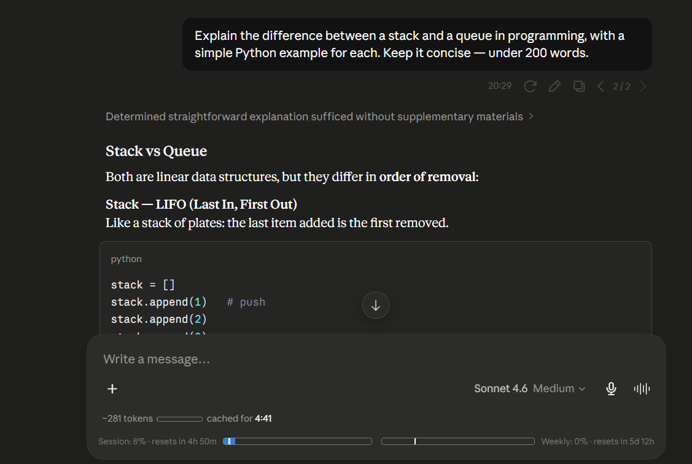

# Claude Counter

Uma extensão de navegador minimalista que exibe contagem de tokens, timer de cache e barras de uso no claude.ai.

## Funcionalidades

- **Contagem de tokens** — Contagem aproximada de tokens da conversa atual, com uma mini barra de progresso em relação ao limite de 200k tokens do contexto
- **Timer de cache** — Contagem regressiva mostrando por quanto tempo a conversa permanece em cache (mais barato continuar)
- **Barras de uso** — Uso de sessão (5 horas) e semanal (7 dias) da API nativa do Claude, com barras de progresso e contagens regressivas de renovação (mais preciso do que a página /usage com valores arredondados)

## Instalação

**Chrome / Edge / Chromium**

1. Baixe [`claude-counter-0.4.2.zip`](../../releases/download/v0.4.2/claude-counter-0.4.2.zip)
2. Acesse `chrome://extensions` e ative o **Modo do desenvolvedor**
3. Arraste e solte o arquivo zip na página

**Firefox**

1. Baixe [`claude-counter-0.4.2.xpi`](../../releases/download/v0.4.2/claude-counter-0.4.2.xpi)
2. Arraste para qualquer janela do Firefox e clique em **Adicionar**

**Userscript**

1. Instale o userscript a partir de [`claude-counter.user.js`](./userscript/claude-counter.user.js)

## Como funciona

- Intercepta as respostas da API do Claude para ler dados de conversa e informações de uso
- Usa um tokenizador empacotado (`o200k_base`) para contagem aproximada de tokens
- Utiliza o endpoint `/usage` do Claude junto com dados SSE `message_limit` em tempo real; o SSE fornece frações de utilização exatas e não arredondadas, tornando as barras de progresso mais precisas do que os percentuais exibidos na página /usage nativa do Claude
- Monitora mudanças no DOM para injetar elementos de UI durante a navegação

## Privacidade

- Todos os dados ficam locais — sem servidores externos, sem rastreamento
- Lê o cookie `lastActiveOrg` para consultar o endpoint `/usage` do Claude
- Faz requisições apenas para `claude.ai`

## Créditos

- Contagem de tokens via [gpt-tokenizer](https://github.com/niieani/gpt-tokenizer) (MIT)
- Inspirado por [Claude Usage Tracker](https://github.com/lugia19/Claude-Usage-Extension) de lugia19

## Licença

MIT
